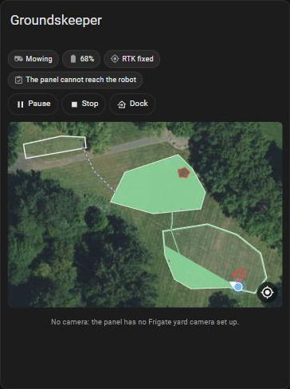

# Groundskeeper for Home Assistant

A Home Assistant integration, installed through [HACS](https://hacs.xyz), that shows your Yarbo robot in Home
Assistant through your [Groundskeeper](https://github.com/Groundskeeper-robot/groundskeeper) panel.

Home Assistant talks to the panel, never to the robot. The panel keeps the robot connection, the safety checks and the
audit log, and Home Assistant reads what the panel knows.

**It reads unless you switch Commands on.** With the **Commands** option (off by default) the mower entity starts,
pauses and docks, and the card gets Start, Pause, Resume, Stop and Dock, all asked of the panel: it sends only with
its own Control switch on and every check passing. See [Commands](#commands).

Independent community project, not affiliated with Yarbo.

## What you need

- A Groundskeeper panel, version **0.20.0 or later** (it has the Home Assistant summary, `GET /api/ha/summary`,
  and reaches the robot through the Yarbo cloud).
- Home Assistant 2026.3 or later, with HACS.
- Home Assistant must be able to reach the panel's address on your network.

## Install

[](https://my.home-assistant.io/redirect/marketplace_repository/?owner=Groundskeeper-robot&repository=groundskeeper-ha&category=integration)

1. **Download it.** The button above opens this repository in your Home Assistant: in the **Marketplace** from
   Home Assistant 2026.11, in **HACS** before that. Choose **Download**. Without the button: Marketplace (or HACS) →
   menu → **Custom repositories**, add `https://github.com/Groundskeeper-robot/groundskeeper-ha` with the type
   **Integration**, then download **Groundskeeper**.
2. Restart Home Assistant.
3. In the panel, go to **Settings → Access** and make an API token named "Home Assistant". It is shown once: copy it.
   An API token can read the panel and ask for robot commands; it can't change settings or switch control on.
4. **Add the integration.**

   [](https://my.home-assistant.io/redirect/config_flow_start/?domain=groundskeeper)

   Or **Settings → Devices & services → Add integration → Groundskeeper**. Enter the address you open the panel at
   (for example `http://192.0.2.20:8425`) and the token.

In Docker, use the panel's IP address: `.local` names often don't resolve inside a container.

## What it shows

One device, **Groundskeeper**, updated every 30 seconds.

| Entity | What it is |
|---|---|
| `lawn_mower.groundskeeper` | Mowing, paused, returning, docked, idle or error (an error code, or stuck), as the panel sees it. No actions in this version. |
| Battery, Positioning, Lawn, State | The battery, the RTK fix (`RTK fixed`, `RTK float`, `single point`, …), the lawn (`Dry`, `Damp`, `Wet`), and the panel's own state text |
| Last run, Next window | When the last run ended, with its result, and when the next schedule window opens, with its plan |
| Start check | `Ready` when a start of the next plan would go out now, else the panel's first reason why not. All reasons are in its attributes. |
| Run in progress, Robot online, Needs attention, Lost contact, Can start, Start waiting for confirmation | On/off. Needs attention is the panel's own stuck check; the mower then shows Error. |
| Diagnostic: Head, Robot link, Control, Waiting for RTK fix, Cloud needs sign-in | How the panel is connected and set up |
| Off by default: Satellites, Run distance, Cloud connection | Turn on what you want to chart |

The start check runs the panel's checks as a program, not a person: anything unknown counts as a fail. Nothing is
sent.

**Unavailable** means Home Assistant can't reach the panel, or the panel has had no robot data for 2 minutes. The
values that come from the robot (battery, positioning, the mower) then show unavailable rather than a stale reading.

The Groundskeeper icon ships inside the integration (`brand/`, Home Assistant 2026.3 and later), so it shows in
**Devices & services** and the **Add integration** list once the download is in place and Home Assistant has restarted.
The HACS store page before 2026.11 doesn't read icons shipped this way and says the icon isn't available; that's
HACS, not a missing file.

## Live: follow camera, map and position

Besides the 30-second summary, the integration keeps the panel's live feed open (`GET /api/ha/stream`, in the panel
release after 0.20.0; with an older panel the rest works and these wait). **Settings → Devices & services →
Groundskeeper → Configure** chooses what it follows:

| Option | Default | What you get |
|---|---|---|
| Map | On | The yard map and the robot's live position for the Groundskeeper card. Nothing in an entity. |
| Follow camera | On | **Follow camera** sensor: the Frigate camera whose coverage holds the robot, as the panel's Live picks it (`covered` is off when none does and it's the first yard camera). **Follow camera** camera entity: that camera's picture through the panel. If Frigate is already in Home Assistant, its own camera entity for the named camera shows the same picture directly. |
| Device tracker | **Off** | **Position**: the robot on Home Assistant's own map, updated every 5 seconds while the feed runs. |
| Commands | **Off** | Start, pause, resume, stop and dock from Home Assistant, through the panel. See [Commands](#commands). |

The card asks Home Assistant, never the panel, so the API token stays on the Home Assistant server: the websocket
commands `groundskeeper/map` and `groundskeeper/subscribe` and the imagery views under
`/api/groundskeeper/<entry>/` need a signed-in Home Assistant user, and pass on only the map, the live feed, imagery
tiles and the yard photo.

## Commands

Off until you switch **Commands** on under **Configure**. Then:

- The mower entity's **Start** resumes a paused plan, or starts the plan the panel's start check names (the one on
  its **Can start** sensor). **Pause** pauses, **Dock** sends it back to its dock. They work in automations too.
- The card shows **Start** (pick a plan, see the panel's checks first), **Pause**, **Resume**, **Stop** and **Dock**.

Home Assistant only asks. The panel sends a command only with its **Control** switch on (Settings → Safety in the
panel) and every check passing, and it holds an API token to its strictest reading: a check it can't answer counts
as a fail, and there is no override. Pause, stop and dock need only the robot online and reachable; the start checks
(yard clear, lawn dry, battery and the rest) are for starting and resuming. A refusal shows the panel's reason. Every command is in the panel's audit log, from "token".

Anyone who can use your Home Assistant dashboards can press these. Nothing else is sent: not the cameras or
keep-awake, no settings, never manual driving.

## The Groundskeeper card



The integration brings its own dashboard card; there is no resource to add. Edit a dashboard, **Add card**, search
for **Groundskeeper**, or in YAML:

```yaml
type: custom:groundskeeper-card
```

It shows:

- **Status:** the mower's state, battery, positioning and the start check. Tap one for its details.
- **Map:** the yard photo with your areas, no-go zones, no-vision zones, pathways and the dock, the current run's track
  coloured by RTK fix (green fixed, amber float, orange single), and the robot with its heading, moving live. The
  crosshair button follows the robot. Needs the **Map** option.
- **Controls**, with the **Commands** option on: **Start** opens the plan list and the panel's checks for it, and
  starts only when the panel says it would; **Pause**, **Stop** and **Dock** go at once; **Resume** asks for a second
  tap. Which ones show follows what the mower is doing. See [Commands](#commands).
- **Follow camera:** the Frigate camera that covers the robot, switching as the robot moves. If Frigate is in Home
  Assistant too, the card uses Frigate's own camera entity for that camera; otherwise the integration's Follow camera
  (through the panel). Needs the **Follow camera** option and Frigate set up in the panel.

Options (all in the visual editor):

| Option | Default | |
|---|---|---|
| `entry_id` | the first robot | Which Groundskeeper entry, with more than one robot |
| `title` | none | A heading |
| `show_status`, `show_controls`, `show_map`, `show_camera` | `true` | Which parts to show (controls only with Commands on) |
| `camera` | `auto` | `auto`: Frigate's own entity when there is one; `integration`: always through the panel |
| `map_height` | `320` | The map's height in pixels |

Without the Commands option the card only reads. It talks to Home Assistant, never to the panel.

## Privacy

The robot's serial number never reaches Home Assistant: the panel names the robot by a hash of it. Its location
reaches Home Assistant's database only if you switch the **Device tracker** on, and then only the tracker's
coordinates. The summary carries no position, map or camera data. The map and live position go only to the card, over
Home Assistant's websocket, and are never written to an entity, so the recorder keeps no history of them. The device
tracker is off by default because a tracker's position is recorded. **Download diagnostics** leaves out the token, the
panel's address, the serial and the position.

## Development

Tests use [pytest-homeassistant-custom-component](https://github.com/MatthewFlamm/pytest-homeassistant-custom-component)
against summaries recorded from the panel's demo mode (`DEMO=1`, a made-up robot in a made-up yard). Home Assistant
doesn't run on Windows; use Linux, macOS, WSL or a container:

```
pip install -r requirements_test.txt
python -m pytest -q
```

Never point tests or a development Home Assistant at a panel connected to a real robot. The panel's own repository
has the safety rules: [AGENTS.md](https://github.com/Groundskeeper-robot/groundskeeper/blob/main/AGENTS.md).

[CodeRabbit](https://coderabbit.ai) reviews each pull request once it is ready for review, and again on each push
(`.coderabbit.yaml`; drafts wait). Its comments are suggestions: fix what is right, reply where it
is wrong, and the maintainer decides.

## License

MIT
